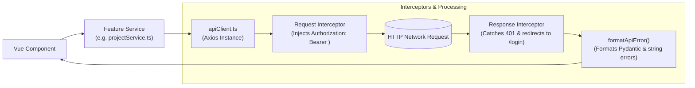

# API Integration & HTTP Client

This document explains how the **Project Management UI** communicates with the FastAPI backend, how the Axios client is configured, how tokens and errors are intercepted, and how backend errors are formatted.

---

## 1. Overview & Architecture

All network communication with the backend is centralized in **`src/services/apiClient.ts`**. Feature services (`authService.ts`, `workspaceService.ts`, `projectService.ts`) never instantiate Axios directly; they always call methods on the shared `apiClient` instance.



---

## 2. Configuration & Environment Variables

The base URL is configured via Vite environment variables:

| Variable | Default Value | Description |
|---|---|---|
| `VITE_API_BASE_URL` | `http://localhost:8000/api/v1` | Root URL for all FastAPI REST endpoints. |

In `src/services/apiClient.ts`:
```typescript
const apiClient = axios.create({
  baseURL: import.meta.env.VITE_API_BASE_URL || 'http://localhost:8000/api/v1',
  headers: {
    'Content-Type': 'application/json',
  },
  timeout: 15000,
})
```

---

## 3. Request Interceptor: Token Injection

Every outgoing request is intercepted before being dispatched over the network. If a JWT token is present in browser storage under `pm_access_token`, the interceptor appends it as a standard HTTP Authorization header:

```typescript
apiClient.interceptors.request.use(
  (config) => {
    const token = localStorage.getItem('pm_access_token')
    if (token) {
      config.headers.Authorization = `Bearer ${token}`
    }
    return config
  },
  (error) => Promise.reject(error)
)
```

---

## 4. Response Interceptor: 401 Session Expiration

If the backend rejects a request with an `HTTP 401 Unauthorized` status (e.g. the token has expired, been revoked, or the user was deleted):
1. Clears `pm_access_token` and `pm_user` from `localStorage`.
2. Checks the current browser URL to prevent infinite redirect loops (avoids redirecting if the user is already on `/login` or `/register`).
3. Redirects the browser to `/login?expired=true` so the user is prompted to sign in again.

```typescript
apiClient.interceptors.response.use(
  (response) => response,
  (error: AxiosError<ApiErrorResponse>) => {
    if (error.response?.status === 401) {
      localStorage.removeItem('pm_access_token')
      localStorage.removeItem('pm_user')

      if (!window.location.pathname.startsWith('/login') && !window.location.pathname.startsWith('/register')) {
        window.location.href = '/login?expired=true'
      }
    }
    return Promise.reject(error)
  }
)
```

---

## 5. Error Parsing with `formatApiError()`

FastAPI returns errors in different formats depending on whether an error was raised manually (`HTTPException`) or triggered by Pydantic schema validation.

The `formatApiError()` utility parses these variations into human-readable strings:

| FastAPI Error Scenario | Backend Response Body | Formatted Output |
|---|---|---|
| **Pydantic Validation Error (HTTP 422)** | `{"detail": [{"loc": ["body", "key"], "msg": "Key must be 2-10 characters"}]}` | `"Key must be 2-10 characters"` |
| **HTTPException (HTTP 400/403/404)** | `{"detail": "A project with key 'PROJ' already exists."}` | `"A project with key 'PROJ' already exists."` |
| **Custom Message Payload** | `{"message": "Service unavailable"}` | `"Service unavailable"` |
| **Backend Offline / Network Error** | `AxiosError.message === "Network Error"` | `"Cannot connect to backend server. Please verify FastAPI is running."` |

### Usage Example in a Component
```typescript
import { formatApiError } from '@/services/apiClient'

try {
  await projectService.createProject(slug, payload)
} catch (err: unknown) {
  errorMessage.value = formatApiError(err)
}
```

---

## 6. Backend CORS Requirements

Because the Vue application runs on `http://localhost:5173` and the FastAPI backend runs on `http://localhost:8000`, the browser blocks cross-origin requests by default unless CORS headers are present.

The FastAPI backend must include `CORSMiddleware` in `src/project_management_api/main.py`:
```python
from fastapi.middleware.cors import CORSMiddleware

app.add_middleware(
    CORSMiddleware,
    allow_origins=[
        "http://localhost:5173",
        "http://127.0.0.1:5173",
    ],
    allow_credentials=True,
    allow_methods=["*"],
    allow_headers=["*"],
)
```
