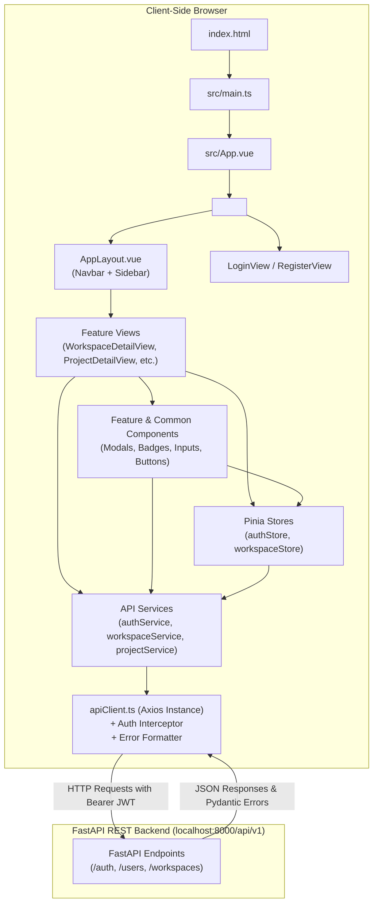

# Application Architecture

This document describes the high-level architecture of the **Project Management UI** (`project-management-ui`), explaining how the application initializes, how directories are organized, and how data flows between views, components, Pinia stores, API services, and the FastAPI backend.

---

## 1. High-Level Architecture Diagram



---

## 2. Application Entry Point & Bootstrapping

| File | Path | Responsibility |
|---|---|---|
| **`index.html`** | `index.html` | HTML container containing the root mount DOM element `<div id="app"></div>` and the Vite module script tag `<script type="module" src="/src/main.ts"></script>`. |
| **`main.ts`** | `src/main.ts` | The TypeScript entry point. Initializes the Vue application instance (`createApp(App)`), registers the Pinia store system (`app.use(pinia)`), registers Vue Router (`app.use(router)`), loads global styles (`import './assets/main.css'`), and mounts the app to `#app`. |
| **`App.vue`** | `src/App.vue` | The top-level component. Calls `authStore.initAuth()` on mount to automatically check for stored JWT credentials and restore authenticated sessions, and renders `<router-view />` to host page views. |

---

## 3. Directory Structure and Responsibilities

The codebase follows a **Feature-Driven Architecture** (screaming architecture). Common components and layout shells are kept in generic directories, while business features (Auth, Workspaces, Projects) are grouped into self-contained feature folders.

```text
src/
├── assets/
│   └── main.css                     # Tailwind CSS v4 imports, global focus-visible styles
├── components/
│   ├── common/                      # Reusable UI primitives (Buttons, Inputs, Badges, Modals)
│   │   ├── AppLogo.vue              # Application branding SVG icon and title
│   │   ├── BaseButton.vue           # Configurable button (primary, outline, danger)
│   │   ├── BaseInput.vue            # Accessible input with label, error, and helper text
│   │   ├── LoadingSpinner.vue       # Animated SVG loading indicator
│   │   ├── StatusBadge.vue          # Feature status pill (API Active, Under Development)
│   │   └── UnderDevelopmentModal.vue# Reusable modal for unbuilt backend operations
│   └── layout/                      # Application shell components
│       ├── AppLayout.vue            # Authenticated two-column responsive layout
│       ├── Navbar.vue               # Top header with user profile, breadcrumbs, and drawer trigger
│       ├── Sidebar.vue              # Left navigation panel with workspace switcher & routes
│       └── WorkspaceDropdown.vue    # Popover dropdown for active workspace selection
├── features/
│   ├── auth/                        # Authentication & User Registration feature
│   │   ├── services/authService.ts  # Axios calls to /auth/login, /auth/register, /users/me
│   │   ├── types/auth.types.ts      # TypeScript interfaces for User, Credentials, Tokens
│   │   └── views/                   # LoginView.vue and RegisterView.vue
│   ├── workspaces/                  # Workspace management feature
│   │   ├── components/              # CreateWorkspaceModal.vue, AddMemberModal.vue
│   │   ├── services/workspaceService.ts # Axios calls to /workspaces/
│   │   ├── types/workspace.types.ts # TypeScript interfaces for Workspace, WorkspaceMember
│   │   └── views/                   # WorkspaceListView.vue, WorkspaceDetailView.vue
│   └── projects/                    # Project management feature
│       ├── components/              # CreateProjectModal.vue, AddProjectMemberModal.vue
│       ├── services/projectService.ts # Axios calls to /workspaces/{slug}/projects/
│       ├── types/project.types.ts   # TypeScript interfaces for Project, ProjectMember
│       └── views/                   # ProjectDetailView.vue, ProjectsPlaceholderView.vue
├── router/
│   └── index.ts                     # Route configuration and authentication guards
├── services/
│   └── apiClient.ts                 # Central Axios instance with interceptors and error formatter
├── stores/
│   ├── auth.ts                      # Pinia store: user profile, token, login/logout
│   └── workspace.ts                 # Pinia store: active workspace, workspace cache
└── types/
    └── api.types.ts                 # Generic API response and error structures
```

---

## 4. Layer Interaction & Data Flow

The application enforces a **unidirectional data flow**:

1. **User Action / Event**:
   A user interacts with a page or modal (e.g. typing into a form, clicking "Create Project").
2. **Component Validation**:
   The view or modal validates the inputs locally (e.g. checks key length or required fields) and displays immediate inline feedback if invalid.
3. **Store / Service Invocation**:
   - If the operation changes global state (e.g. login, selecting an active workspace), the component calls an action on a Pinia store (`authStore` or `workspaceStore`).
   - If the operation is scoped to a specific view (e.g. fetching project members or adding a project member), the component directly invokes the corresponding service method (`projectService.addProjectMember()`).
4. **API Client (`apiClient.ts`)**:
   The service uses the centralized Axios instance.
   - The **Request Interceptor** reads `pm_access_token` from `localStorage` and appends `Authorization: Bearer <token>` to the HTTP headers.
   - The request travels over HTTP to the FastAPI backend at `http://localhost:8000/api/v1`.
5. **Backend Processing & Response**:
   FastAPI verifies JWT permissions, executes the database query via SQLAlchemy, and returns a JSON payload or HTTP error status.
6. **Response Interceptor & Error Formatting**:
   - On `401 Unauthorized`, `apiClient` automatically clears credentials and redirects to `/login`.
   - On error responses, `formatApiError()` parses FastAPI's `detail` (whether a string or Pydantic validation array) into a readable string.
7. **View Update**:
   The component receives the typed response and updates its reactive state (`ref`, `reactive`), causing Vue's virtual DOM to re-render the UI.

---

## 5. Key Architecture Principles

1. **Backend Decoupling**:
   The frontend is an independent Vite Single Page Application. It has zero Python dependencies and communicates with the backend strictly through HTTP REST contracts.
2. **Type Parity with Pydantic**:
   Every TypeScript interface in `src/features/*/types/` mirrors the exact attributes, uppercase enums (`ProjectRole`, `WorkspaceRole`, `ProjectStatus`), and nested shapes defined in FastAPI's Pydantic schemas.
3. **Honest Status Handling**:
   Unbuilt backend endpoints (such as `PUT` / `DELETE` for workspaces or task boards) are not faked with mock data. Instead, they explicitly trigger `<UnderDevelopmentModal />` with informative notices.
4. **Consistent Design & Accessibility**:
   The UI uses Tailwind CSS v4, accessible semantic markup, custom focus rings (`#6366f1`), and responsive layouts tailored for mobile, tablet, and desktop viewports.
