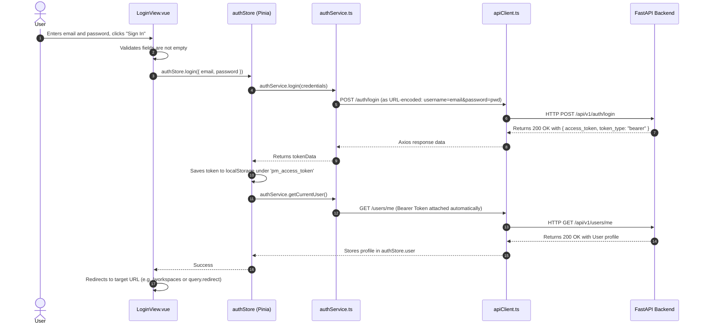

# Authentication & Authorization

This document covers the authentication system of the **Project Management UI**, including user registration, login via FastAPI's OAuth2 password flow, JWT token persistence, user profile retrieval, and session expiration handling.

---

## 1. Feature Purpose

The authentication feature provides:
- Secure account creation for new users.
- Credential validation and JWT token issuance.
- Persistent user sessions across page reloads using browser `localStorage`.
- Automatic authorization header injection on all outbound API requests.
- Automatic session cleanup and redirect upon token expiration (HTTP 401).

---

## 2. Main Files & Responsibilities

| File | Path | Responsibility |
|---|---|---|
| **`LoginView.vue`** | `src/features/auth/views/LoginView.vue` | The sign-in page. Collects email and password, handles login submission, and displays validation or backend error messages. |
| **`RegisterView.vue`** | `src/features/auth/views/RegisterView.vue` | The sign-up page. Collects full name, email, password, and password confirmation. Automatically logs the user in after successful registration. |
| **`authService.ts`** | `src/features/auth/services/authService.ts` | Centralized API client methods for authentication endpoints (`login`, `register`, `getCurrentUser`). |
| **`auth.types.ts`** | `src/features/auth/types/auth.types.ts` | TypeScript interfaces for `User`, `LoginCredentials`, `RegisterPayload`, and `TokenResponse`. |
| **`auth.ts`** | `src/stores/auth.ts` | Pinia store managing reactive authentication state (`token`, `user`, `isAuthenticated`, `isLoading`, `isInitialized`). |

---

## 3. Backend API Endpoints Used

| Endpoint | HTTP Method | Request Content-Type | Payload / Params | Response | Description |
|---|---|---|---|---|---|
| `/auth/register` | `POST` | `application/json` | `{ email, full_name, password }` | `User` object (`id`, `email`, `full_name`, `is_active`, `is_superuser`, `created_at`) | Registers a new user account. |
| `/auth/login` | `POST` | `application/x-www-form-urlencoded` | `username` (email) and `password` | `TokenResponse` (`access_token`, `token_type: "bearer"`) | Authenticates user via FastAPI `OAuth2PasswordRequestForm`. |
| `/users/me` | `GET` | `application/json` | Header: `Authorization: Bearer <token>` | `User` object | Fetches profile of the currently authenticated user. |

---

## 4. Step-by-Step Workflows

### A. Login Workflow

### B. Registration Workflow
1. User enters their Full Name, Email, Password, and Password Confirmation on `/register`.
2. `RegisterView.vue` verifies that:
   - All fields are filled.
   - Passwords match.
   - Password is at least 8 characters long.
3. If valid, calls `authStore.register({ full_name, email, password })`.
4. `authService.register()` sends a JSON POST request to `/api/v1/auth/register`.
5. Upon 200 OK, the view automatically calls `authStore.login({ email, password })`.
6. Once logged in, the user is navigated directly to `/workspaces`.

### C. Persistent Session & Startup Hydration (`initAuth`)
When a user opens the application or refreshes the page:
1. `App.vue` or `router.beforeEach` triggers `authStore.initAuth()`.
2. If `localStorage.getItem('pm_access_token')` contains a token:
   - Sets `authStore.token = token`.
   - Calls `authService.getCurrentUser()` to verify the token is still valid on the backend.
   - Populates `authStore.user` with the fresh user profile.
3. If the token is invalid or expired:
   - Catches the error and calls `authStore.logout()`, removing the token from `localStorage`.
4. Marks `isInitialized = true` so route guards can proceed.

### D. Logout & 401 Session Expiration
- **Manual Logout**: User clicks "Sign Out" in `Navbar.vue` → calls `authStore.logout()` → resets `token` and `user` to `null` → navigates to `/login`.
- **Automatic 401 Interception**: In `src/services/apiClient.ts`, a global response interceptor checks for `error.response.status === 401`. If a 401 occurs, it removes `pm_access_token` and redirects the window to `/login?expired=true`.

---

## 5. Error Handling & Form Feedback

- **Client-Side Validation**: Form inputs highlight in red if requirements are violated before calling the backend.
- **Backend Validation Errors**: FastAPI returns 400 Bad Request or 422 Unprocessable Entity with a `{ detail: ... }` payload. `formatApiError()` automatically parses these details (e.g. `"A user with this email already exists."`) and displays them inside a dismissible alert box.
- **Loading State**: The "Sign In" and "Create Account" buttons disable and render a spinning indicator while the network request is inflight.
