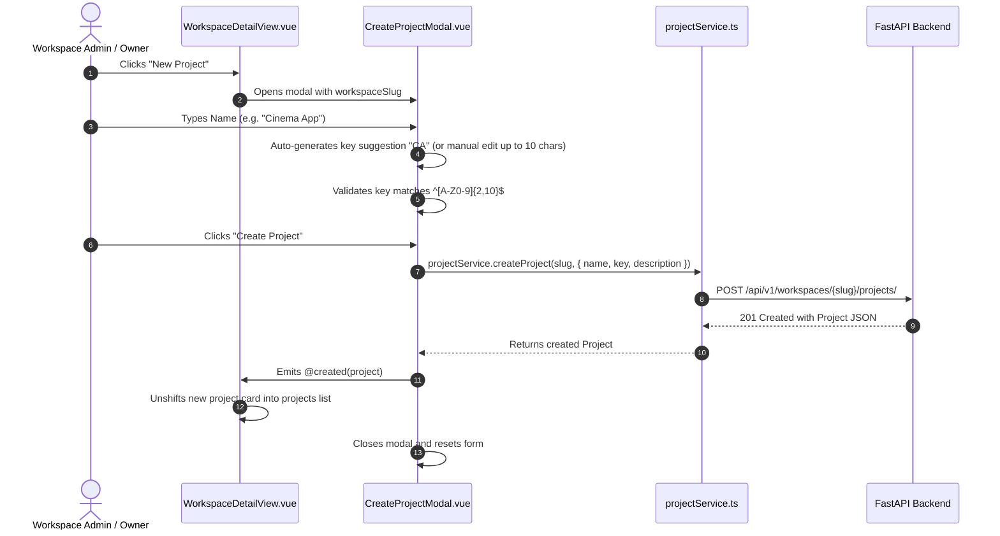

# Project Management

This document covers the project module of the **Project Management UI**, explaining how projects are nested inside workspaces, how short keys work, how project members are assigned, and how project data flows through the application.

---

## 1. Feature Purpose

Projects represent specific initiatives, software repositories, or campaigns contained within a workspace.
- Implements FastAPI's **Step 19: Nested REST Routing** (`/api/v1/workspaces/{slug}/projects/`).
- Every project has a unique short alphanumeric **Key** (e.g. `PROJ`, `CIN`, `API`) scoped to its workspace.
- Users access projects via human-readable nested URLs: `/workspaces/:slug/projects/:key`.
- Members must already be in the parent workspace before they can be assigned to a project.
- The project creator is automatically assigned the `PROJECT_LEAD` role.

---

## 2. Main Files & Responsibilities

| File | Path | Responsibility |
|---|---|---|
| **`ProjectDetailView.vue`** | `src/features/projects/views/ProjectDetailView.vue` | Dedicated view for `/workspaces/:slug/projects/:key`. Displays project header, metadata, member list, and upcoming tasks roadmap. |
| **`ProjectsPlaceholderView.vue`** | `src/features/projects/views/ProjectsPlaceholderView.vue` | Global `/projects` hub with an active workspace selector, allowing users to view and manage projects across their workspaces. |
| **`CreateProjectModal.vue`** | `src/features/projects/components/CreateProjectModal.vue` | Dialog modal for creating a project. Features automatic key suggestion and validation. |
| **`AddProjectMemberModal.vue`** | `src/features/projects/components/AddProjectMemberModal.vue` | Dialog modal for assigning a workspace member to a project with a role. |
| **`projectService.ts`** | `src/features/projects/services/projectService.ts` | Centralized Axios service methods for all nested project endpoints. |
| **`project.types.ts`** | `src/features/projects/types/project.types.ts` | TypeScript interfaces for `Project`, `ProjectStatus`, `ProjectRole`, `ProjectMember`, and payloads. |

---

## 3. Backend API Endpoints Used

All project endpoints are nested under the workspace slug:

| Endpoint | HTTP Method | Payload | Auth / Permission | Description |
|---|---|---|---|---|
| `/workspaces/{slug}/projects/` | `GET` | URL param `slug` | Workspace member | Lists all projects visible to the user in this workspace. |
| `/workspaces/{slug}/projects/` | `POST` | `{ name: string, key: string, description?: string }` | Workspace `OWNER` or `ADMIN` | Creates a new project. Key must be 2–10 uppercase alphanumeric characters (`^[A-Z0-9]{2,10}$`). Creator becomes `PROJECT_LEAD`. |
| `/workspaces/{slug}/projects/{key}` | `GET` | URL params `slug`, `key` | Project member or Workspace `OWNER`/`ADMIN` | Returns a single project's details by its short key. |
| `/workspaces/{slug}/projects/{key}/members` | `GET` | URL params `slug`, `key` | Project member or Workspace `OWNER`/`ADMIN` | Lists all members assigned to this project with their project roles. |
| `/workspaces/{slug}/projects/{key}/members` | `POST` | `{ email: string, role: ProjectRole }` | Workspace `OWNER`/`ADMIN` or `PROJECT_LEAD` | Adds an existing workspace member to the project. |

---

## 4. Step-by-Step Workflows

### A. Creating a Project

### B. Viewing Project Details (`ProjectDetailView.vue`)
1. User navigates to `/workspaces/:slug/projects/:key` (or clicks "Open" on a project card).
2. The page executes `loadProjectData()`:
   - Fetches project metadata via `projectService.getProject(slug, key)`.
   - Fetches project members via `projectService.getProjectMembers(slug, key)`.
3. Renders:
   - Breadcrumb navigation: `Workspaces / {slug} / {projectName}`.
   - Header banner with Project Key badge, Status badge, and timestamps.
   - Tabs:
     - **Overview**: Description, metadata statistics, and quick member list.
     - **Project Members**: Detailed member table with roles and assignment dates.
     - **Tasks & Board**: Honest status preview for upcoming task tracking.

### C. Adding a Member to a Project
1. User clicks **Add Member** button on `ProjectDetailView.vue`.
2. `AddProjectMemberModal.vue` opens.
3. User enters the member's email address and selects their project role:
   - `CONTRIBUTOR`: Can create and work on tasks.
   - `VIEWER`: Read-only project access.
   - `PROJECT_LEAD`: Can manage project settings and assign members.
4. Submitting calls `projectService.addProjectMember(slug, key, { email, role })`.
5. Upon 201 Created, emits `member-added` event.
6. `ProjectDetailView.vue` refreshes its member list.

---

## 5. Roles & Status Enums

### Project Roles (`ProjectRole`)
| Role | Badge Color | Description |
|---|---|---|
| **`PROJECT_LEAD`** | Purple (`bg-purple-50 text-purple-700`) | Lead coordinator; can add members to the project. |
| **`CONTRIBUTOR`** | Indigo (`bg-indigo-50 text-indigo-700`) | Standard team member contributing to tasks. |
| **`VIEWER`** | Slate (`bg-slate-100 text-slate-700`) | Read-only access to project resources. |

### Project Statuses (`ProjectStatus`)
| Status | Badge Color | Meaning |
|---|---|---|
| **`ACTIVE`** | Emerald (`bg-emerald-50 text-emerald-700`) | Project is ongoing and actively worked on. |
| **`COMPLETED`** | Blue (`bg-blue-50 text-blue-700`) | Project milestones have been finished. |
| **`ARCHIVED`** | Slate (`bg-slate-100 text-slate-600`) | Inactive or closed project kept for records. |

---

## 6. Project Tasks & Incomplete Operations

- **Tasks & Kanban Boards**: Fully implemented in **Steps 20–22**! Tasks belong to projects and can be managed directly on the project detail view. See [`docs/TASKS.md`](./TASKS.md) for full details.
- **Unimplemented Endpoints**:
  - `PUT /workspaces/{slug}/projects/{key}` (Update Project Details)
  - `DELETE /workspaces/{slug}/projects/{key}` (Delete Project)
  
Clicking "Edit" or "Delete" on `ProjectDetailView.vue` triggers `<UnderDevelopmentModal />`, which explains that these operations are part of upcoming development steps.
