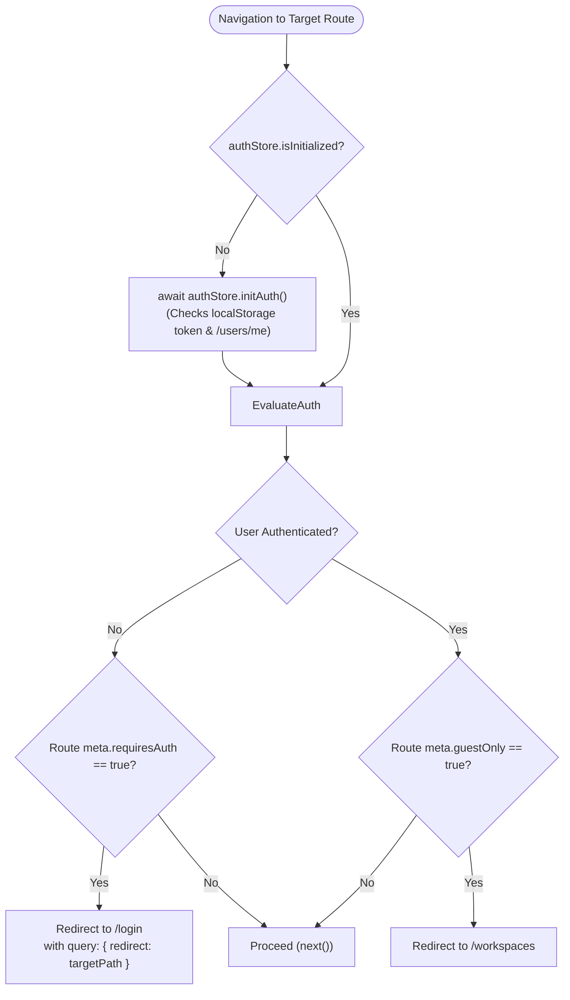

# Application Routing and Navigation

This document explains the routing system of the **Project Management UI** (`src/router/index.ts`), how frontend client routes differ from backend API endpoints, and how navigation guards protect sensitive pages.

---

## 1. Frontend Routes vs. Backend API Endpoints

It is critical to distinguish between **Frontend Client Routes** and **Backend REST API Endpoints**:

- **Frontend Routes** (e.g. `/workspaces/alpha/projects/PROJ`): Handled entirely in the user's browser by **Vue Router 4** using the HTML5 History API (`createWebHistory`). Navigating between these routes does **not** trigger a full browser reload; it only swaps Vue components inside the page shell.
- **Backend API Endpoints** (e.g. `GET /api/v1/workspaces/{slug}/projects/{key}`): Handled by **FastAPI** on the backend server. These are invoked asynchronously over HTTP via Axios in service files.

---

## 2. Route Registry

The application routes are configured in `src/router/index.ts`:

| Route Path | Route Name | Target View Component | Auth Requirement | Layout Shell | Description |
|---|---|---|---|---|---|
| `/login` | `login` | `src/features/auth/views/LoginView.vue` | `guestOnly: true` | Blank (No Shell) | User authentication form for existing accounts. |
| `/register` | `register` | `src/features/auth/views/RegisterView.vue` | `guestOnly: true` | Blank (No Shell) | New user registration form. |
| `/` | — | Redirect to `/workspaces` | `requiresAuth: true` | `AppLayout.vue` | Root route automatically redirects to the workspaces dashboard. |
| `/workspaces` | `workspaces` | `src/features/workspaces/views/WorkspaceListView.vue` | `requiresAuth: true` | `AppLayout.vue` | Dashboard displaying all workspaces the user belongs to, with creation modal. |
| `/workspaces/:slug` | `workspace-detail` | `src/features/workspaces/views/WorkspaceDetailView.vue` | `requiresAuth: true` | `AppLayout.vue` | Detailed view for a specific workspace, showing project cards, team members, and settings. |
| `/workspaces/:slug/projects/:key` | `project-detail` | `src/features/projects/views/ProjectDetailView.vue` | `requiresAuth: true` | `AppLayout.vue` | Detailed view for a single project inside a workspace, showing members and task roadmap. |
| `/projects` | `projects` | `src/features/projects/views/ProjectsPlaceholderView.vue` | `requiresAuth: true` | `AppLayout.vue` | Cross-workspace project navigation hub with active workspace switcher. |
| `/:pathMatch(.*)*` | — | Redirect to `/workspaces` | None | N/A | Catch-all wildcard for invalid URLs; redirects users to `/workspaces`. |

---

## 3. Route Details and Page Breakdown

### A. Login Route (`/login`)
- **Route Name**: `login`
- **File**: `src/features/auth/views/LoginView.vue`
- **Components Used**: `BaseInput`, `BaseButton`, `AppLogo`
- **Associated API**: `POST /api/v1/auth/login` (via `authService.login`)
- **Behavior**: If the user is already authenticated, the guard immediately redirects them to `/workspaces`. If navigating here after session expiry, displays an informational notice (`?expired=true`). If redirected from a protected page, retains the target URL via `?redirect=...`.

### B. Register Route (`/register`)
- **Route Name**: `register`
- **File**: `src/features/auth/views/RegisterView.vue`
- **Components Used**: `BaseInput`, `BaseButton`, `AppLogo`
- **Associated API**: `POST /api/v1/auth/register` (via `authService.register`)
- **Behavior**: Upon successful registration, automatically invokes `authStore.login()` with the submitted credentials and redirects to `/workspaces`.

### C. Workspace List Route (`/workspaces`)
- **Route Name**: `workspaces`
- **File**: `src/features/workspaces/views/WorkspaceListView.vue`
- **Components Used**: `CreateWorkspaceModal`, `BaseButton`, `StatusBadge`, `LoadingSpinner`, `UnderDevelopmentModal`
- **Associated APIs**:
  - `GET /api/v1/workspaces/` (via `workspaceStore.fetchWorkspaces`)
  - `POST /api/v1/workspaces/` (via `workspaceStore.createWorkspace`)
- **Behavior**: Renders cards for each workspace. Clicking a card navigates to `/workspaces/:slug`.

### D. Workspace Detail Route (`/workspaces/:slug`)
- **Route Name**: `workspace-detail`
- **File**: `src/features/workspaces/views/WorkspaceDetailView.vue`
- **Components Used**: `CreateProjectModal`, `AddMemberModal`, `StatusBadge`, `BaseButton`, `LoadingSpinner`, `UnderDevelopmentModal`
- **Associated APIs**:
  - `GET /api/v1/workspaces/{slug}`
  - `GET /api/v1/workspaces/{slug}/members`
  - `GET /api/v1/workspaces/{slug}/projects/`
  - `POST /api/v1/workspaces/{slug}/projects/`
  - `POST /api/v1/workspaces/{slug}/members`
- **Behavior**: Loads workspace data by slug. Features tab navigation (Projects, Team Members, Management). Project cards link directly to `/workspaces/:slug/projects/:key`.

### E. Project Detail Route (`/workspaces/:slug/projects/:key`)
- **Route Name**: `project-detail`
- **File**: `src/features/projects/views/ProjectDetailView.vue`
- **Components Used**: `AddProjectMemberModal`, `StatusBadge`, `BaseButton`, `LoadingSpinner`, `UnderDevelopmentModal`
- **Associated APIs**:
  - `GET /api/v1/workspaces/{slug}/projects/{key}`
  - `GET /api/v1/workspaces/{slug}/projects/{key}/members`
  - `POST /api/v1/workspaces/{slug}/projects/{key}/members`
- **Behavior**: Displays project metadata and key badge. Allows project leads and workspace admins to assign workspace members to the project. Displays an honest roadmap for upcoming task endpoints.

### F. Projects Navigation Hub Route (`/projects`)
- **Route Name**: `projects`
- **File**: `src/features/projects/views/ProjectsPlaceholderView.vue`
- **Components Used**: `CreateProjectModal`, `BaseButton`, `StatusBadge`, `LoadingSpinner`
- **Associated APIs**:
  - `GET /api/v1/workspaces/`
  - `GET /api/v1/workspaces/{slug}/projects/`
- **Behavior**: Provides a top-level projects dashboard with a dropdown allowing the user to view projects from any workspace they belong to without first opening the workspace detail page.

---

## 4. Navigation Guards & Route Protection

Route protection is managed centrally in `src/router/index.ts` using `router.beforeEach`:

### Route Meta Attributes
- **`requiresAuth: true`**: Applied to the parent route `'/'` and inherited by all child routes (`/workspaces`, `/workspaces/:slug`, `/workspaces/:slug/projects/:key`, `/projects`). Unauthenticated visitors are blocked and redirected to `/login`.
- **`guestOnly: true`**: Applied to `/login` and `/register`. Authenticated users attempting to visit login/register are intercepted and redirected straight to `/workspaces`.
