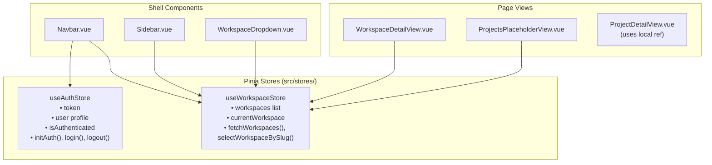

# State Management with Pinia

This document explains the state management architecture of the **Project Management UI**, detailing how **Pinia** is used, what data is stored globally versus locally, and how stores are hydrated and reset.

---

## 1. Overview & Architecture

The application uses **Pinia** for cross-cutting global state that must be shared across multiple routes or layout components. Feature-specific data that is only needed by a single page is kept inside local component state (`ref`, `reactive`) to avoid store bloat.



---

## 2. Global Stores

### A. Authentication Store (`src/stores/auth.ts`)
Manages the user's active session, JWT token, and profile data.

#### State
| Property | Type | Description |
|---|---|---|
| `token` | `ref<string \| null>` | Initialized from `localStorage.getItem('pm_access_token')`. |
| `user` | `ref<User \| null>` | The authenticated user's profile object returned from `/users/me`. |
| `isLoading` | `ref<boolean>` | True while authentication requests are inflight. |
| `isInitialized` | `ref<boolean>` | True after the initial token verification has completed. |

#### Computed / Getters
| Getter | Type | Description |
|---|---|---|
| `isAuthenticated` | `computed<boolean>` | Returns `true` if `token` is non-null. |

#### Actions
- **`initAuth()`**: Called once at app startup (in `App.vue` or router guards). Reads the persisted token, fetches `/users/me`, and validates the session. If the token is invalid, calls `logout()`.
- **`login(credentials)`**: Submits login form data to `/auth/login`, persists the received JWT token in `localStorage`, and fetches the user profile.
- **`register(payload)`**: Calls `/auth/register` to create a new user account.
- **`logout()`**: Clears `token`, `user`, and removes `pm_access_token` from `localStorage`.

---

### B. Workspace Store (`src/stores/workspace.ts`)
Manages the user's workspace list and keeps track of the currently active workspace selected in the top bar or sidebar.

#### State
| Property | Type | Description |
|---|---|---|
| `workspaces` | `ref<Workspace[]>` | Array of workspaces the user belongs to. |
| `currentWorkspace` | `ref<Workspace \| null>` | The currently selected workspace. |
| `isLoading` | `ref<boolean>` | Loading indicator for workspace list operations. |
| `error` | `ref<string \| null>` | Error message string if an operation fails. |

#### Actions
- **`fetchWorkspaces()`**: Calls `workspaceService.getWorkspaces()`, populates `workspaces`, and defaults `currentWorkspace` to the first workspace if not already set.
- **`selectWorkspaceBySlug(slug)`**: Checks the local `workspaces` array first. If found, updates `currentWorkspace`. If not cached, fetches the workspace from `/workspaces/{slug}`.
- **`createWorkspace(payload)`**: Submits new workspace data to `/workspaces/`, unshifts the newly created workspace to the front of `workspaces`, and sets it as `currentWorkspace`.
- **`reset()`**: Resets all state to initial empty values (called upon user logout).

---

## 3. Data Ownership Guidelines: Store vs. Component State

To maintain clean code and avoid unnecessary reactivity overhead, use this decision framework:

| Data Type | Where to Store | Justification | Example |
|---|---|---|---|
| **User Session & Identity** | Pinia (`useAuthStore`) | Needed by the router, navigation guards, layout headers, and API interceptors. | `token`, `user` |
| **Active Workspace Context** | Pinia (`useWorkspaceStore`) | Shared between top navbar dropdown, sidebar links, and projects views. | `currentWorkspace` |
| **Workspace List** | Pinia (`useWorkspaceStore`) | Used by the workspace switcher and dashboard. | `workspaces` |
| **Project Details & Members** | Component (`ref` in `ProjectDetailView.vue`) | Only needed while visiting that specific project page. Does not need to stay in global memory. | `project`, `members` |
| **Form Inputs & Modal State** | Component (`ref` in Modals) | Ephemeral UI state that should be reset when the modal closes. | `email`, `role`, `showModal` |
| **Filter & Tab State** | Component (`ref` in Views) | Specific to the user's current view tab. | `activeTab = 'overview'` |

---

## 4. State Resetting on Logout

When a user logs out, the application ensures that no sensitive workspace or user information lingers in memory:

```typescript
function handleLogout() {
  authStore.logout()
  workspaceStore.reset()
  router.push('/login')
}
```
This guarantees that if another user signs in on the same browser session, they will not see cached data from the previous account.
