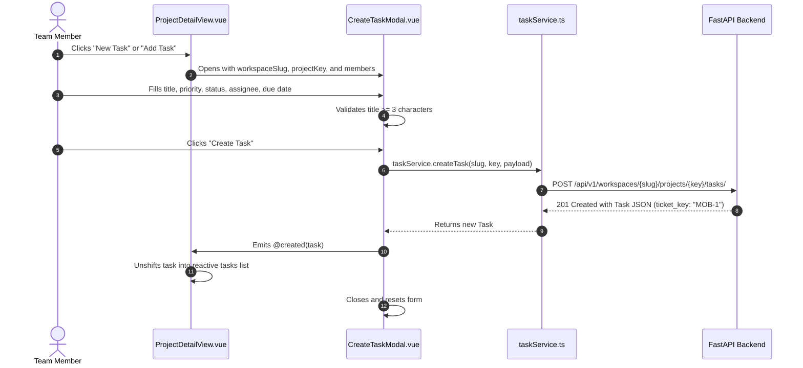

# Task Management & Kanban Board

This document covers the task management module of the **Project Management UI**, detailing how tasks are modeled, how sequential Jira-style ticket keys (`MOB-1`) are created, how the Kanban board and list views work, and how state machine transitions are handled.

---

## 1. Feature Purpose

Tasks are the fundamental work items in the platform:
- Implements FastAPI's **Steps 20–22: Task Management & State Machine** (`/api/v1/workspaces/{slug}/projects/{key}/tasks/`).
- Every task belongs to a specific project and is identified by a sequential, human-readable **Ticket Key** (e.g. `MOB-1`, `MOB-2`, `CIN-12`).
- Tasks move through a lifecycle state machine: `BACKLOG` → `TODO` → `IN_PROGRESS` → `IN_REVIEW` → `DONE` (or `CANCELLED`).
- Tasks support priority tiers: `LOW`, `MEDIUM`, `HIGH`, and `URGENT`.
- Tasks can be assigned to existing workspace members and carry optional due dates.

---

## 2. Main Files & Responsibilities

| File | Path | Responsibility |
|---|---|---|
| **`task.types.ts`** | `src/features/tasks/types/task.types.ts` | TypeScript interfaces for `Task`, `TaskStatus`, `TaskPriority`, `TaskCreatePayload`, `TaskUpdatePayload`, and `TaskFilterParams`. |
| **`taskService.ts`** | `src/features/tasks/services/taskService.ts` | Centralized Axios service methods for task listing, creation, single-task lookup, and partial updates (`PATCH`). |
| **`TaskCard.vue`** | `src/features/tasks/components/TaskCard.vue` | Kanban card displaying ticket key badge (`MOB-1`), title, priority pill, assignee avatar, due date, and quick advancement button. |
| **`CreateTaskModal.vue`** | `src/features/tasks/components/CreateTaskModal.vue` | Dialog modal for creating a task with title, description, priority, status, assignee, and due date. |
| **`TaskDetailModal.vue`** | `src/features/tasks/components/TaskDetailModal.vue` | Detailed view and inline edit dialog for updating task status, priority, description, and assignee. |
| **`ProjectDetailView.vue`** | `src/features/projects/views/ProjectDetailView.vue` | Hosts the interactive **Kanban Board**, **List View**, filter bar, and project completion statistics. |

---

## 3. Backend API Endpoints Used

All task endpoints are nested under the workspace slug and project key:

| Endpoint | HTTP Method | Payload / Query Params | Permission Required | Description |
|---|---|---|---|---|
| `/workspaces/{slug}/projects/{key}/tasks/` | `GET` | Query params: `status`, `priority` | Project Member or Workspace Admin | Returns all tasks matching the filters for the project. |
| `/workspaces/{slug}/projects/{key}/tasks/` | `POST` | `TaskCreatePayload`: `{ title, description?, status?, priority?, assignee_email?, due_date? }` | `CONTRIBUTOR`, `PROJECT_LEAD`, or Workspace Admin (`VIEWER` cannot create) | Creates a task with a concurrency-safe sequential ticket key (e.g. `MOB-1`). |
| `/workspaces/{slug}/projects/{key}/tasks/{task_number}` | `GET` | URL param `task_number` (int) | Project Member or Workspace Admin | Fetches a single task by its integer number. |
| `/workspaces/{slug}/projects/{key}/tasks/{task_number}` | `PATCH` | `TaskUpdatePayload`: Partial `{ title?, description?, status?, priority?, assignee_email?, due_date? }` | `CONTRIBUTOR`, `PROJECT_LEAD`, or Workspace Admin (`VIEWER` cannot edit) | Updates task attributes or transitions lifecycle status. |

---

## 4. Step-by-Step Workflows

### A. Task Creation Workflow

### B. Kanban Board & Lifecycle Transitions
1. `ProjectDetailView.vue` groups tasks by their `status` into 4 primary columns:
   - **To Do** (`TODO`)
   - **In Progress** (`IN_PROGRESS`)
   - **In Review** (`IN_REVIEW`)
   - **Done** (`DONE`)
2. Users can advance a task in two ways:
   - **Quick Action Button**: On hovering over a card, an arrow button (`→`) advances the card to the next logical state (`TODO` → `IN_PROGRESS` → `IN_REVIEW` → `DONE`).
   - **Task Detail Dialog**: Clicking any card opens `TaskDetailModal.vue`, where a status selector allows immediate transition to any state.
3. The status update is dispatched via `taskService.updateTask(slug, key, taskNumber, { status })`.
4. Upon response, the local task array updates reactively, immediately moving the card to its new Kanban column.

### C. Task Filtering
The controls bar on `ProjectDetailView.vue` provides:
- **Priority Filter**: `ALL`, `URGENT`, `HIGH`, `MEDIUM`, `LOW`.
- **Status Filter**: `ALL`, `BACKLOG`, `TODO`, `IN_PROGRESS`, `IN_REVIEW`, `DONE`, `CANCELLED`.
- Changing any filter triggers `loadTasks()`, querying FastAPI with `?status=...&priority=...`.

---

## 5. Data Handling & State Ownership

- **Local Component State**: Task lists and active filters are managed inside `ProjectDetailView.vue` using Vue `ref<Task[]>`. Because tasks are strictly scoped to an individual project, they are fetched on entry and cleared on exit, avoiding global store memory bloat.
- **Optimistic Updates**: Immediate local list updates occur when tasks are created or updated, preventing full page reloads.

---

## 6. Roles & Permissions

- **`OWNER` / `ADMIN`**: Can create, edit, reassign, and transition any task in any project.
- **`PROJECT_LEAD` / `CONTRIBUTOR`**: Can create and edit tasks in their assigned projects.
- **`VIEWER`**: Can view task boards and inspect details, but the backend rejects create/update requests with `403 Forbidden`. The UI handles this via `formatApiError()`.

---

## 7. Priority & Status Badges

### Priorities (`TaskPriority`)
| Priority | Pill Class | Indicator Color |
|---|---|---|
| **`URGENT`** | `bg-rose-50 text-rose-700 border-rose-200` | Red |
| **`HIGH`** | `bg-amber-50 text-amber-700 border-amber-200` | Amber |
| **`MEDIUM`** | `bg-indigo-50 text-indigo-700 border-indigo-200` | Indigo |
| **`LOW`** | `bg-slate-100 text-slate-700 border-slate-200` | Gray / Slate |

### Lifecycle States (`TaskStatus`)
| Status | Meaning |
|---|---|
| **`BACKLOG`** | Idea or unplanned work item. |
| **`TODO`** | Planned and ready to be worked on. |
| **`IN_PROGRESS`** | Actively being developed. |
| **`IN_REVIEW`** | In code review, testing, or QA. |
| **`DONE`** | Completed and closed. |
| **`CANCELLED`** | Abandoned or discarded. |
