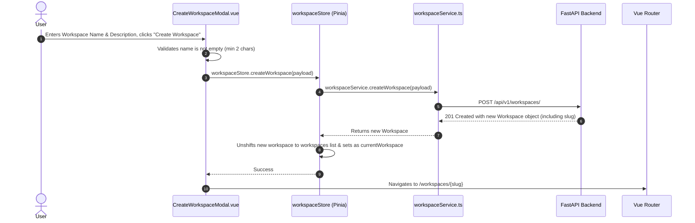

# Workspace Management

This document covers the workspace module of the **Project Management UI**, explaining workspace creation, membership management, roles, and how workspaces serve as the multi-tenant boundary for projects and members.

---

## 1. Feature Purpose

Workspaces are the top-level container for team collaboration in the application.
- All projects, task boards, and team memberships belong to a specific workspace.
- Users can belong to multiple workspaces with distinct roles.
- The creator of a workspace is automatically assigned the `OWNER` role.
- Workspaces enforce Role-Based Access Control (RBAC) across projects and invitations.

---

## 2. Main Files & Responsibilities

| File | Path | Responsibility |
|---|---|---|
| **`WorkspaceListView.vue`** | `src/features/workspaces/views/WorkspaceListView.vue` | Main workspaces dashboard. Lists all workspaces the user belongs to with quick stats, links to detail pages, and a "New Workspace" modal trigger. |
| **`WorkspaceDetailView.vue`** | `src/features/workspaces/views/WorkspaceDetailView.vue` | Detail page for a specific workspace. Features a responsive 3-tab layout: **Projects**, **Team Members**, and **Management**. |
| **`CreateWorkspaceModal.vue`** | `src/features/workspaces/components/CreateWorkspaceModal.vue` | Dialog modal for creating a new workspace with a name and optional description. |
| **`AddMemberModal.vue`** | `src/features/workspaces/components/AddMemberModal.vue` | Dialog modal for inviting/adding an existing user by email with a role (`MEMBER`, `ADMIN`, or `OWNER`). |
| **`WorkspaceDropdown.vue`** | `src/components/layout/WorkspaceDropdown.vue` | Custom popover dropdown in the application shell (Navbar/Sidebar) allowing fast switching of the active workspace. |
| **`workspaceService.ts`** | `src/features/workspaces/services/workspaceService.ts` | Centralized Axios service methods for all `/workspaces` endpoints. |
| **`workspace.types.ts`** | `src/features/workspaces/types/workspace.types.ts` | TypeScript types for `Workspace`, `WorkspaceRole`, `WorkspaceMember`, and payloads. |
| **`workspace.ts`** | `src/stores/workspace.ts` | Pinia store managing `workspaces`, `currentWorkspace`, and active workspace caching. |

---

## 3. Backend API Endpoints Used

| Endpoint | HTTP Method | Payload | Auth / Role | Description |
|---|---|---|---|---|
| `/workspaces/` | `GET` | None | Authenticated user | Returns all workspaces the current user is a member of. |
| `/workspaces/` | `POST` | `{ name: string, description?: string }` | Authenticated user | Creates a new workspace. Backend auto-generates a unique `slug` and assigns creator as `OWNER`. |
| `/workspaces/{slug}` | `GET` | URL param `slug` | Workspace member | Fetches workspace details (`name`, `slug`, `description`, `created_at`). |
| `/workspaces/{slug}/members` | `GET` | URL param `slug` | Workspace member | Returns all members of the workspace with their roles and joined dates. |
| `/workspaces/{slug}/members` | `POST` | `{ email: string, role: WorkspaceRole }` | `OWNER` or `ADMIN` | Adds an existing user to the workspace. |

---

## 4. Step-by-Step Workflows

### A. Creating a Workspace

### B. Viewing a Workspace (`WorkspaceDetailView.vue`)
1. On route enter (`/workspaces/:slug`), `loadWorkspaceData()` executes.
2. Runs parallel HTTP requests via `Promise.all`:
   - `workspaceService.getWorkspace(slug)`
   - `workspaceService.getWorkspaceMembers(slug)`
   - `projectService.getProjects(slug)`
3. Populates:
   - `workspace`: Name, slug, description, creation date.
   - `members`: Team members table with roles.
   - `projects`: Live project cards in the Overview/Projects tab.
4. Also sets `workspaceStore.currentWorkspace = workspace.value` so the top Navbar dropdown stays synchronized.

### C. Adding a Member to a Workspace
1. User clicks **Add Member** button on `WorkspaceDetailView.vue`.
2. `AddMemberModal.vue` opens.
3. User enters the member's registered email address and selects their role:
   - `MEMBER`: Regular workspace collaborator.
   - `ADMIN`: Can manage workspace members and create projects.
   - `OWNER`: Full ownership permissions.
4. Submitting calls `workspaceService.addWorkspaceMember(slug, { email, role })`.
5. Upon successful creation, emits `member-added` event.
6. `WorkspaceDetailView.vue` triggers `loadWorkspaceData()` to refresh the member list.

---

## 5. Roles & Badges

Roles are strictly uppercase strings matching the backend `WorkspaceRole` enum:

| Role | Badge Color | Permissions Summary |
|---|---|---|
| **`OWNER`** | Purple (`bg-purple-50 text-purple-700`) | Full control: create projects, invite members, modify/delete workspace. |
| **`ADMIN`** | Indigo (`bg-indigo-50 text-indigo-700`) | Administrative control: create projects and invite members. |
| **`MEMBER`** | Blue (`bg-blue-50 text-blue-700`) | Standard collaborator: view workspace, participate in assigned projects. |

---

## 6. Incomplete / Under-Development Features

The following backend workspace endpoints have not yet been implemented in FastAPI:
- `PUT /workspaces/{slug}` (Update Workspace Name/Description)
- `DELETE /workspaces/{slug}` (Delete Workspace)

When these actions are clicked in `WorkspaceDetailView.vue` (under the **Management** tab), the UI gracefully displays `<UnderDevelopmentModal />` with a friendly explanatory message, ensuring no simulated or fake API requests are made.
